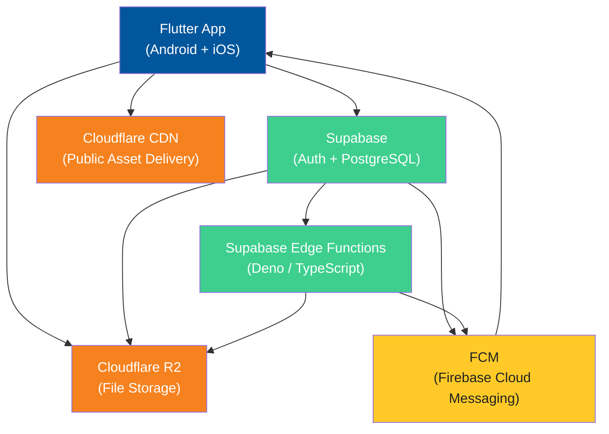
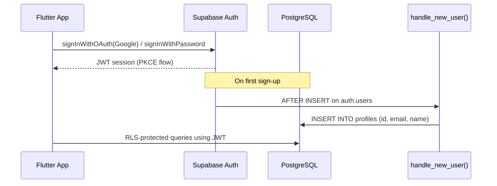
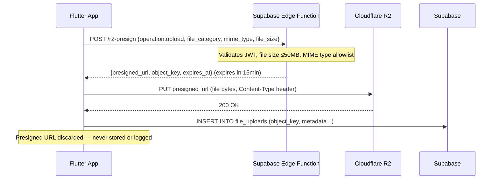
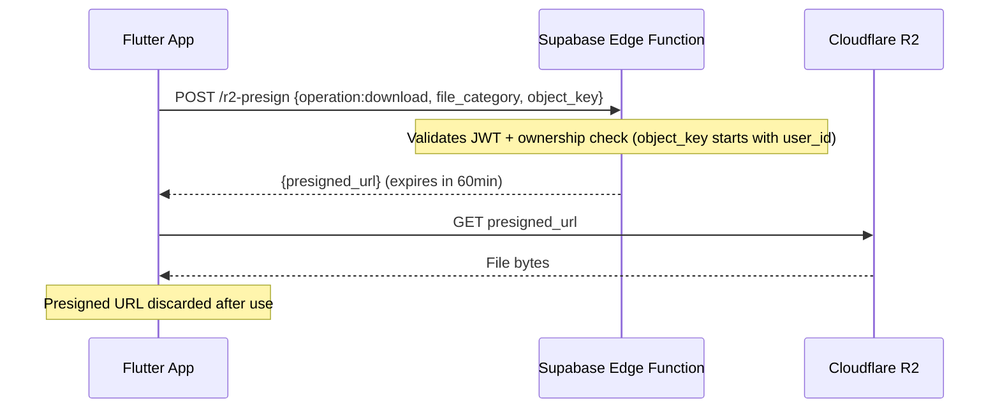
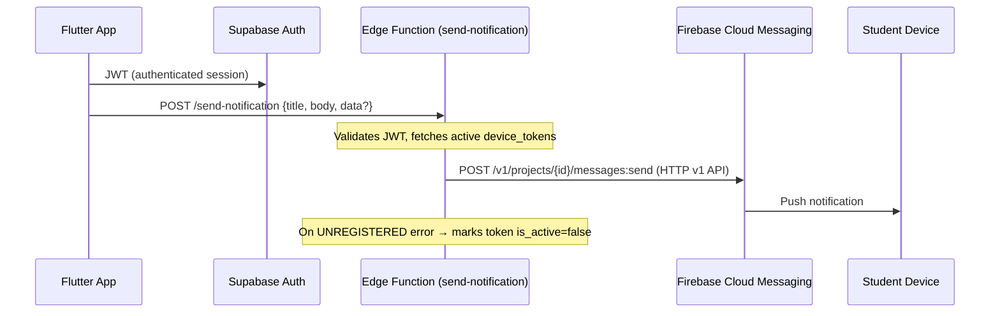
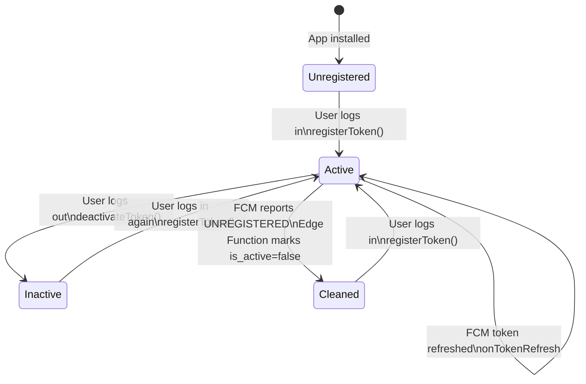
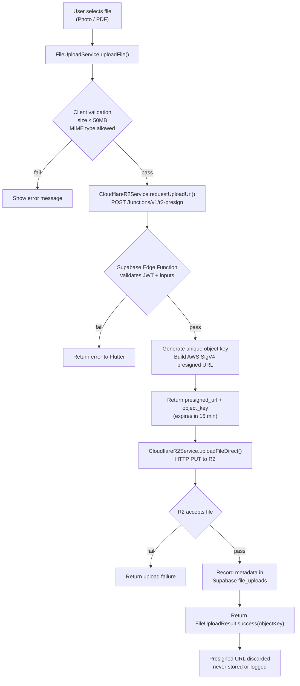
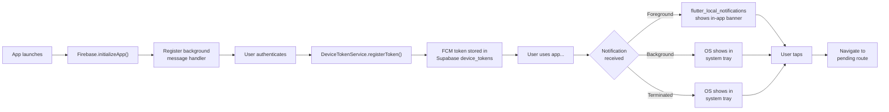

# SCORE — Production Infrastructure Architecture

> **Last updated:** November 2026  
> **Status:** Code-complete. Manual dashboard configuration required before production deployment.  
> See [INFRASTRUCTURE_SETUP.md](INFRASTRUCTURE_SETUP.md) for the step-by-step configuration guide.

---

## Table of Contents

1. [System Overview](#1-system-overview)
2. [Supabase Architecture](#2-supabase-architecture)
3. [Cloudflare R2 Architecture](#3-cloudflare-r2-architecture)
4. [Cloudflare CDN Architecture](#4-cloudflare-cdn-architecture)
5. [Firebase Cloud Messaging Architecture](#5-firebase-cloud-messaging-architecture)
6. [Data Flows](#6-data-flows)
7. [Security Architecture](#7-security-architecture)
8. [Environment Variables](#8-environment-variables)
9. [Database Schema Changes](#9-database-schema-changes)
10. [Scaling Considerations](#10-scaling-considerations)

---

## 1. System Overview

SCORE is a competitive exam practice engine for Indian students (JEE, NEET) targeting national-scale traffic. The production infrastructure integrates four services:



### Key design principles

| Principle | Implementation |
|-----------|---------------|
| No secrets in Flutter | R2 keys, FCM service account, Supabase service-role key — all stay server-side |
| RLS as security boundary | Every Supabase table with user data has Row Level Security enabled |
| Presigned URLs are temporary credentials | Expire in 15 min (upload) / 60 min (download); never logged |
| Graceful degradation | Firebase failure → app continues normally; R2 failure → non-fatal |
| Supabase is not replaced | Google Auth, PostgreSQL, and all existing features are preserved |

---

## 2. Supabase Architecture

### Authentication



**Auth flow:** PKCE — no implicit grant, no server-side token exchange needed.  
**Redirect URL:** `score://login-callback` (registered in AndroidManifest.xml and Supabase dashboard).  
**Session persistence:** `supabase_flutter` handles token refresh automatically.

### Database Tables

| Table | RLS | Purpose |
|-------|-----|---------|
| `profiles` | ✅ | Student profile, stats, avatar |
| `questions` | ✅ (read-only for authenticated) | Question bank (JEE/NEET PYQs) |
| `bookmarks` | ✅ (owner) | Student question bookmarks |
| `mistakes` | ✅ (owner) | Smart mistake notebook |
| `test_attempts` | ✅ (owner) | Mock test history |
| `question_notes` | ✅ (owner) | Custom revision notes |
| `file_uploads` | ✅ (owner) | R2 file metadata references |
| `device_tokens` | ✅ (owner) | FCM push notification tokens |

### Edge Functions

| Function | Trigger | Purpose |
|----------|---------|---------|
| `r2-presign` | POST (authenticated) | Generate R2 presigned upload/download URLs |
| `send-notification` | POST (authenticated) | Send FCM push notifications via HTTP v1 API |

### Audit Findings and Resolutions

| Finding | Severity | Resolution |
|---------|----------|------------|
| Missing indexes on `questions`, `mistakes`, `test_attempts` | Medium | Migration 002 adds 15 performance indexes |
| Supabase anon key hardcoded in source | Acceptable | Documented — anon key is a publishable key by design |
| Local SQLite stores plaintext password | Dev shortcut | Not modified per explicit user rule 11 |
| No DELETE policy on `profiles` | Intentional | Cascaded via `auth.users ON DELETE CASCADE` |
| `questions` has no INSERT/UPDATE/DELETE policies | Correct | Admin-only via service-role key |

---

## 3. Cloudflare R2 Architecture

### Bucket Structure

| Bucket | Access | Contents | CDN |
|--------|--------|----------|-----|
| `score-public-assets` | Public (read) | Question images, diagrams, educational PDFs | ✅ via custom domain |
| `score-private-uploads` | Private (presigned only) | User documents, personal uploads | ❌ Never |

### Object Key Convention

```
{user_id}/{file_category}/{random_16_hex}.{ext}
```

Example:
- Public: `a1b2c3.../question_images/4f9a2b1c3d8e5a7f.jpg`
- Private: `a1b2c3.../user_documents/9d4c7b2a1e6f3c8d.pdf`

This design means:
- Object keys are **not user-guessable** (UUID-prefixed + random ID)
- File paths cannot be enumerated without server-side access
- Cross-user access is blocked by the Edge Function ownership check

### Upload Flow



### Download Flow (Private Files)



### CORS Configuration for R2 Buckets

Apply this configuration in Cloudflare R2 dashboard → bucket → Settings → CORS:

```json
[
  {
    "AllowedOrigins": ["*"],
    "AllowedMethods": ["PUT", "GET"],
    "AllowedHeaders": ["Content-Type", "Content-Length"],
    "ExposeHeaders": ["ETag"],
    "MaxAgeSeconds": 3600
  }
]
```

> [!IMPORTANT]  
> For production, restrict `AllowedOrigins` to your app's specific domains/schemes rather than `"*"`.

---

## 4. Cloudflare CDN Architecture

### How it Works

Cloudflare CDN serves public assets from R2 via a custom domain. The Flutter app constructs CDN URLs using `CdnService`:

```
https://cdn.YOUR-DOMAIN.com/{object_key}
```

### Cache Control Strategy

| Asset Type | Cache Policy | Cache-Control Header |
|-----------|--------------|---------------------|
| Question images (versioned key) | Long-lived immutable | `public, max-age=31536000, immutable` |
| Educational PDFs | Long-lived | `public, max-age=86400` |
| Public study materials | Medium-lived | `public, max-age=3600` |
| Private user documents | Never cached publicly | `private, no-store` |
| Supabase API responses | Never cached by CDN | Managed by Supabase |

> [!CAUTION]
> Never route private R2 bucket through a public CDN domain. Private files must always go through the presigned URL mechanism.

### Cache Invalidation

Since object keys include a random unique component (`{random_16_hex}`), **cache invalidation is not normally required**. When a file is updated, a new object key is generated naturally.

For forced invalidation (e.g., removing a file from cache immediately):
1. Cloudflare Dashboard → Cache → Purge Cache → Custom Purge
2. Enter the full CDN URL(s) to purge

---

## 5. Firebase Cloud Messaging Architecture

### Notification Flow



### Device Token Lifecycle



### App State Handling

| App State | FCM Behavior | Local Notification |
|-----------|-------------|-------------------|
| Foreground | `onMessage` stream fires | ✅ Shown via flutter_local_notifications |
| Background | System tray shows notification | ❌ Not needed (system handles it) |
| Terminated | System tray shows notification | ❌ Not needed |
| Notification tap (background) | `onMessageOpenedApp` fires | Navigation route consumed on ready |
| Notification tap (terminated) | `getInitialMessage()` returns message | Navigation deferred until app ready |

### iOS APNs Requirements

FCM on iOS requires APNs to be configured. This cannot be done in code:

1. Create APNs Authentication Key in Apple Developer Portal
2. Upload the key (`.p8` file) to Firebase Console
3. Configure push notification capability in Xcode
4. Add background mode `remote-notification` in Info.plist ✅ (done)

---

## 6. Data Flows

### Complete File Upload Flow



### Push Notification Flow



---

## 7. Security Architecture

### Credential Locations

| Credential | Location | In Flutter? |
|-----------|----------|-------------|
| Supabase anon key | `supabase_config.dart` (publishable) | ✅ Safe — by design |
| Supabase service-role key | Supabase Edge Function secrets | ❌ Never |
| R2 Access Key ID | Supabase Edge Function secrets | ❌ Never |
| R2 Secret Access Key | Supabase Edge Function secrets | ❌ Never |
| Firebase service account JSON | Supabase Edge Function secrets | ❌ Never |
| FCM device tokens | Supabase `device_tokens` table (RLS) | Received only |
| Google OAuth Client ID | `supabase_config.dart` (publishable) | ✅ Safe — public OAuth client |

### Security Checklist

#### ✅ Implemented in code

- [x] No R2 credentials in Flutter source or assets
- [x] No Firebase service account in Flutter
- [x] No Supabase service-role key in Flutter
- [x] RLS enabled on all user-data tables (profiles, bookmarks, mistakes, test_attempts, question_notes, file_uploads, device_tokens)
- [x] Presigned URL ownership enforced server-side (private object_key starts with user_id)
- [x] Presigned URLs never logged or stored
- [x] File size validated server-side (≤ 50 MB)
- [x] MIME type validated server-side (allowlist)
- [x] FCM token deactivated on logout (before Supabase signOut)
- [x] Device tokens protected by RLS (users cannot see other users' tokens)
- [x] Upload expiry: 15 minutes; download expiry: 60 minutes
- [x] FCM invalid token cleanup after UNREGISTERED error
- [x] No presigned URL logging in Edge Functions
- [x] Background FCM handler is a top-level function (not a closure)
- [x] Notification permissions NOT requested at cold launch
- [x] `.env` and `google-services.json` excluded from git

#### ⏳ Requires manual dashboard configuration

- [ ] R2 CORS configured with production origins (not `"*"`)
- [ ] Private R2 bucket has no public access rules
- [ ] Public R2 bucket CDN domain is not connected to private bucket
- [ ] Firebase APNs key uploaded in Firebase Console
- [ ] Supabase Edge Function secrets set for all 7 required variables
- [ ] Supabase Edge Functions deployed with `supabase functions deploy`
- [ ] SQL migrations 001 and 002 executed in Supabase SQL editor
- [ ] `google-services.json` added to `android/app/`
- [ ] `GoogleService-Info.plist` added to Xcode Runner target

---

## 8. Environment Variables

### Flutter App (compile-time `--dart-define` flags)

| Variable | Required | Default | Description |
|----------|----------|---------|-------------|
| `SUPABASE_URL` | Optional | Hardcoded in `supabase_config.dart` | Supabase project URL |
| `SUPABASE_ANON_KEY` | Optional | Hardcoded in `supabase_config.dart` | Supabase publishable key |
| `GOOGLE_WEB_CLIENT_ID` | Optional | Hardcoded in `supabase_config.dart` | Google OAuth web client ID |
| `R2_PUBLIC_DOMAIN` | Optional | Empty string | CDN base URL for public assets |

### Supabase Edge Function Secrets

Set via: `supabase secrets set KEY=VALUE`

| Secret Name | Required | Description |
|------------|----------|-------------|
| `SUPABASE_URL` | Auto-set | Set automatically by Supabase |
| `SUPABASE_SERVICE_ROLE_KEY` | Auto-set | Set automatically by Supabase |
| `CLOUDFLARE_ACCOUNT_ID` | ✅ | Cloudflare account identifier |
| `R2_ACCESS_KEY_ID` | ✅ | R2 API token access key |
| `R2_SECRET_ACCESS_KEY` | ✅ | R2 API token secret key |
| `R2_BUCKET_PUBLIC` | ✅ | Public bucket name (e.g., `score-public-assets`) |
| `R2_BUCKET_PRIVATE` | ✅ | Private bucket name (e.g., `score-private-uploads`) |
| `R2_ENDPOINT` | ✅ | R2 S3 endpoint (`https://{ACCOUNT_ID}.r2.cloudflarestorage.com`) |
| `FIREBASE_PROJECT_ID` | ✅ | Firebase project identifier |
| `FIREBASE_SERVICE_ACCOUNT_JSON` | ✅ | Complete service account JSON (from Firebase Console) |

---

## 9. Database Schema Changes

### Migration 001 — New Tables

**`public.file_uploads`** — R2 file metadata references

| Column | Type | Constraints |
|--------|------|-------------|
| id | UUID | PK, default gen_random_uuid() |
| owner_id | UUID | FK → auth.users, ON DELETE CASCADE |
| bucket_name | TEXT | NOT NULL |
| object_key | TEXT | NOT NULL, UNIQUE(bucket_name, object_key) |
| original_file_name | TEXT | NOT NULL |
| mime_type | TEXT | NOT NULL |
| file_size | BIGINT | NOT NULL, CHECK > 0 |
| file_category | TEXT | CHECK enum |
| visibility | TEXT | CHECK 'public'/'private' |
| upload_status | TEXT | CHECK 'pending'/'completed'/'failed' |
| created_at | TIMESTAMPTZ | DEFAULT now() |
| updated_at | TIMESTAMPTZ | Auto-updated via trigger |

**`public.device_tokens`** — FCM device registration

| Column | Type | Constraints |
|--------|------|-------------|
| id | UUID | PK, default gen_random_uuid() |
| user_id | UUID | FK → auth.users, ON DELETE CASCADE |
| device_id | TEXT | UNIQUE(user_id, device_id) |
| fcm_token | TEXT | NOT NULL |
| platform | TEXT | CHECK 'android'/'ios' |
| is_active | BOOLEAN | DEFAULT true |
| notification_enabled | BOOLEAN | DEFAULT true |
| last_seen_at | TIMESTAMPTZ | DEFAULT now() |
| created_at | TIMESTAMPTZ | DEFAULT now() |
| updated_at | TIMESTAMPTZ | Auto-updated via trigger |

### Migration 002 — Performance Indexes

15 indexes added across `questions`, `mistakes`, `test_attempts`, `bookmarks`, `question_notes`. No schema changes.

---

## 10. Scaling Considerations

### Design Decisions for National-Scale Traffic (India)

| Concern | Decision |
|---------|----------|
| File uploads | Direct-to-R2 via presigned URL — Supabase Edge Functions are NOT in the upload data path |
| Public asset delivery | Cloudflare CDN with long-lived cache — reduces R2 egress for repeated content |
| Object keys | Random UUID components prevent hotspot key patterns in R2 |
| FCM | Per-user token targeting — no broadcast; Edge Function fans out per-device |
| Database | Indexes on all user-specific filter columns; RLS uses `auth.uid()` which is indexed |
| Session management | Supabase JWT auto-refresh — no server round-trips for session validation |
| Local SQLite | Offline capability for question practice without network dependency |
| Token cleanup | Invalid FCM tokens cleaned server-side on each notification send |

### Not Introduced (intentional)

- No Redis / Valkey cache layer (premature for current scale)
- No message broker (SNS/SQS/Pub-Sub) — FCM handles fan-out
- No Kubernetes / container orchestration — Supabase Edge Functions scale automatically
- No video streaming — explicitly excluded from scope

### Future Scaling Path

When SCORE approaches 100k+ concurrent users:
1. Add Supabase `read replicas` for high-read queries
2. Partition large tables (`questions`, `test_attempts`) by `exam_id`
3. Consider Cloudflare Workers for server-side rendering of public content
4. Implement token batching in `send-notification` for bulk notifications

